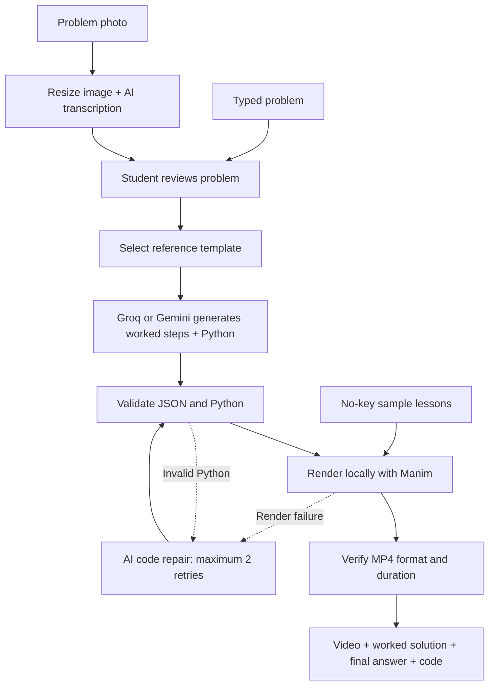

# IntuitionLens

Turn a math or physics problem into a short animation and a worked solution.

- Upload a photo (JPG/PNG/WebP, up to 10 MB), type a problem, or try a sample.
- Get a video, visual intuition, formulas, explanations, and line-by-line calculations.
- Covers derivatives, integrals, projectiles, vectors, and trigonometry.
- Runs locally with FastAPI and Manim. No LaTeX or Node.js build needed.

## Quick start — Windows / PowerShell

**You need:** Python 3.11+ and FFmpeg tools (`ffmpeg` and `ffprobe`) on PATH. Tested on Windows with Python 3.14.4 and Manim 0.22.1.

Skip the first two commands if you already have the project open.

```powershell
git clone https://github.com/EdsonRay05/new_hack_ai.git intuition-lens
cd intuition-lens
python -m venv .venv
.\.venv\Scripts\python.exe -m pip install -r requirements.txt
if (!(Test-Path .env)) { Copy-Item .env.example .env }
notepad .env
```

## Add your API key

- Create your own key at [Groq Console](https://console.groq.com/keys). Keep your account on the Free plan for free-tier use.
- In `.env`, edit these lines; keep the other settings from `.env.example`:

```dotenv
AI_PROVIDER=groq
GROQ_API_KEY=PASTE_YOUR_KEY_HERE
```

- `GROQ_MODEL` handles solutions/code; `GROQ_VISION_MODEL` reads photos. Model access depends on your account.
- Optional Gemini: set `AI_PROVIDER=gemini` and fill in `GEMINI_API_KEY` instead.
- **Never commit `.env` or share your key.** Samples work without a key.

## Run

```powershell
.\.venv\Scripts\python.exe -m uvicorn main:app --host 127.0.0.1 --port 8000
```

- Open **http://127.0.0.1:8000**.
- Stop with **Ctrl+C**. Restart after changing `.env` or Python code.
- Upload a photo → **Read this problem** → review/correct the text → **Make it click**.
- Or choose **Type it out** / a sample card.
- Play or download the MP4, then read the solution cards and final answer.

## How it works



- **Browser:** HTML, CSS, and JavaScript.
- **Backend:** FastAPI handles uploads, jobs, and progress.
- **AI:** reads photos and generates explanations/code; Manim creates the video locally.
- **Output:** videos in `static/outputs/`; scripts and diagnostics in `media/`.

## Useful commands

```powershell
# Check video tools
ffmpeg -version
ffprobe -version

# Check Groq access (uses one API request)
.\.venv\Scripts\python.exe scripts/diagnose_provider.py

# Run tests
.\.venv\Scripts\python.exe -m pip install -r requirements-dev.txt
.\.venv\Scripts\python.exe -m unittest discover -s tests -v

# Pre-render all five samples for an offline demo
.\.venv\Scripts\python.exe scripts/verify_renders.py
```

## If something fails

- **Rate limit:** follow the displayed wait or use samples. Restarting does not reset provider quotas.
- **Photo model unavailable:** use **Type it out** and check your account's model access.
- **Render failure:** inspect the displayed diagnostic path under `media/`.
- **Missing FFmpeg/FFprobe:** add their `bin` folder to PATH, then reopen your terminal.

## Important

- Photos and problem text go to your selected AI provider; avoid personal information.
- Review AI-generated math. Rendering successfully does not prove an answer is correct.
- Use on **localhost only**. Generated Python runs as your user; validation is not a full security sandbox.
- See [AI_DEVELOPMENT.md](AI_DEVELOPMENT.md) for development and verification details.
