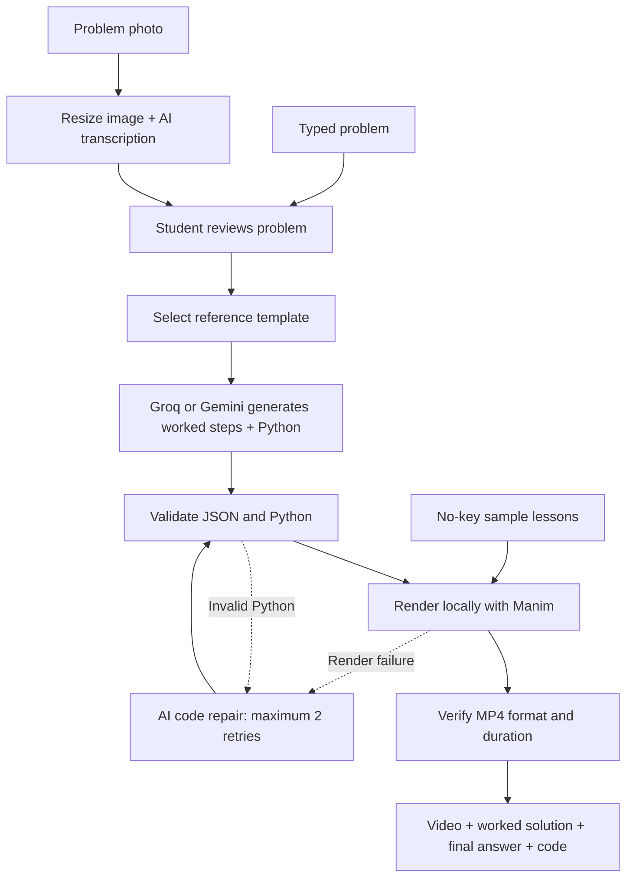

# IntuitionLens

**See what the equation means, then learn how to solve it.**

IntuitionLens is a local STEM learning prototype that pairs a student's own problem with a short animation and a worked explanation: **formula → why it applies → detailed calculations → final answer**.

## Research context

- **The Philippine learning challenge:** In PISA 2022, **16% of participating Filipino 15-year-olds** reached mathematics proficiency Level 2 or higher, compared with 69% across OECD countries. This provides context for the need to strengthen mathematical understanding; it is not a calculus-specific assessment. [OECD, Philippines country note (2023)](https://www.oecd.org/en/publications/pisa-2022-results-volume-i-and-ii-country-notes_ed6fbcc5-en/philippines_a0882a2d-en.html)
- **Evidence from a Philippine classroom:** A quasi-experimental study of **60 Grade 11 STEM learners** at Valencia National High School in Ormoc City reported higher conic-section post-test scores with GeoGebra-assisted instruction than with traditional instruction. The study was limited to a short intervention and a teacher-made assessment. [Lumanta (2026), *Southeast Asian Journal of STEM Education*, pp. 83–95](https://www.seameo-stemed.org/wp-content/uploads/2023/12/SAJSE-Vol6-No1_Jan-2026.pdf#page=90)
- **Broader evidence for visual learning:** A meta-analysis of **41 studies involving 10,562 learners** found a positive average effect of visualization interventions on mathematics learning, with substantial variation across studies. [Schoenherr, Strohmaier & Schukajlow (2024), *Educational Research Review*](https://doi.org/10.1016/j.edurev.2024.100639)

**Our design response:** connect equations with visible mathematical behavior, then explain the rules and intermediate steps used to solve the problem.

*These findings motivate the approach; they do not demonstrate that IntuitionLens improves learning. The prototype still needs evaluation with students, including checks of mathematical accuracy and understanding.*

## What you can do

- Upload a photo (JPG/PNG/WebP, up to 10 MB), type a problem, or try a sample.
- Get a video, visual intuition, formulas, explanations, and line-by-line calculations.
- Covers derivatives, integrals, projectiles, vectors, and trigonometry.
- Runs locally with FastAPI and Manim. No LaTeX or Node.js build needed.

## Quick start — Windows / PowerShell

**You need:** Python 3.11+ and FFmpeg tools (`ffmpeg` and `ffprobe`) on PATH. Tested on Windows with Python 3.14.4 and Manim 0.22.1.

Skip the first two commands if you already have the project open.

```powershell
git clone https://github.com/EdsonRay05/new_hack_ai.git intuition-lens
cd intuition-lens
python -m venv .venv
.\.venv\Scripts\python.exe -m pip install -r requirements.txt
if (!(Test-Path .env)) { Copy-Item .env.example .env }
notepad .env
```

## Add your API key

- Create your own key at [Groq Console](https://console.groq.com/keys). Keep your account on the Free plan for free-tier use.
- In `.env`, edit these lines; keep the other settings from `.env.example`:

```dotenv
AI_PROVIDER=groq
GROQ_API_KEY=PASTE_YOUR_KEY_HERE
```

- `GROQ_MODEL` handles solutions/code; `GROQ_VISION_MODEL` reads photos. Model access depends on your account.
- Optional Gemini: set `AI_PROVIDER=gemini` and fill in `GEMINI_API_KEY` instead.
- **Never commit `.env` or share your key.** Samples work without a key.

## Run

```powershell
.\.venv\Scripts\python.exe -m uvicorn main:app --host 127.0.0.1 --port 8000
```

- Open **http://127.0.0.1:8000**.
- Stop with **Ctrl+C**. Restart after changing `.env` or Python code.
- Upload a photo → **Read this problem** → review/correct the text → **Make it click**.
- Or choose **Type it out** / a sample card.
- Play or download the MP4, then read the solution cards and final answer.

## How it works



- **Browser:** HTML, CSS, and JavaScript.
- **Backend:** FastAPI handles uploads, jobs, and progress.
- **AI:** reads photos and generates explanations/code; Manim creates the video locally.
- **Output:** videos in `static/outputs/`; scripts and diagnostics in `media/`.

## Useful commands

```powershell
# Check video tools
ffmpeg -version
ffprobe -version

# Check Groq access (uses one API request)
.\.venv\Scripts\python.exe scripts/diagnose_provider.py

# Run tests
.\.venv\Scripts\python.exe -m pip install -r requirements-dev.txt
.\.venv\Scripts\python.exe -m unittest discover -s tests -v

# Pre-render all five samples for an offline demo
.\.venv\Scripts\python.exe scripts/verify_renders.py
```

## If something fails

- **Rate limit:** follow the displayed wait or use samples. Restarting does not reset provider quotas.
- **Photo model unavailable:** use **Type it out** and check your account's model access.
- **Render failure:** inspect the displayed diagnostic path under `media/`.
- **Missing FFmpeg/FFprobe:** add their `bin` folder to PATH, then reopen your terminal.

## Important

- Photos and problem text go to your selected AI provider; avoid personal information.
- Review AI-generated math. Rendering successfully does not prove an answer is correct.
- Use on **localhost only**. Generated Python runs as your user; validation is not a full security sandbox.
- See [AI_DEVELOPMENT.md](AI_DEVELOPMENT.md) for development and verification details.
